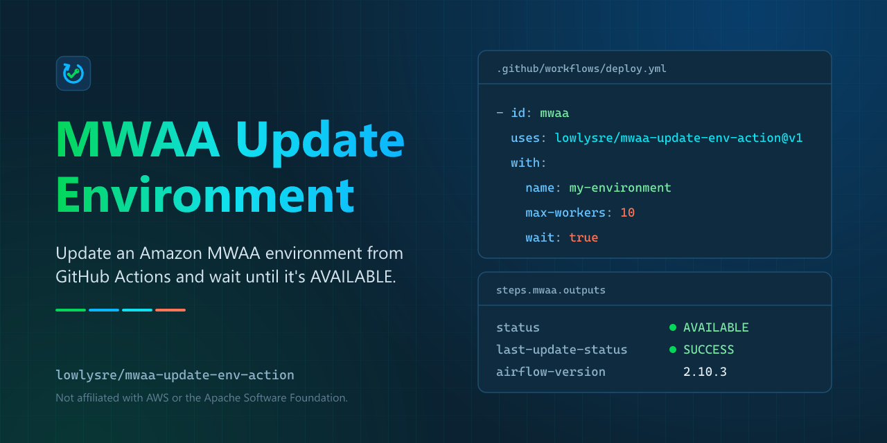

<p align="center">
  
</p>

<p align="center">
  <a href="https://github.com/lowlysre/mwaa-update-env-action/actions/workflows/ci.yml"></a>
  <a href="LICENSE"></a>
</p>

# MWAA Update Environment

Update an Amazon MWAA environment from GitHub Actions and, optionally, wait until it is `AVAILABLE` again. The action calls the same API as `aws mwaa update-environment`, sends only the settings you set, and fails the step if the update fails.

It authenticates with the AWS credentials already in the job environment, so it needs no MWAA CLI tokens and no AWS CLI on the runner. Run [aws-actions/configure-aws-credentials](https://github.com/aws-actions/configure-aws-credentials) first.

This action is built and maintained by [lowlysre](https://github.com/lowlysre). It's an independent project, not affiliated with or endorsed by AWS.

## Quick start

This example assumes the repository can use GitHub OIDC to assume an AWS role that can update the environment. See [AWS credentials and permissions](docs/guides.md#aws-credentials-and-permissions) for the trust policy and the IAM actions the role needs.

```yaml
permissions:
  contents: read
  id-token: write

steps:
  - uses: actions/checkout@v7

  - uses: aws-actions/configure-aws-credentials@v6
    with:
      role-to-assume: ${{ secrets.AWS_ROLE_ARN }}
      aws-region: us-east-1

  - id: upload
    name: Upload requirements.txt
    run: |
      version=$(aws s3api put-object --bucket my-mwaa-bucket --key requirements.txt \
        --body requirements.txt --query VersionId --output text)
      echo "version=$version" >> "$GITHUB_OUTPUT"

  - id: mwaa
    uses: lowlysre/mwaa-update-env-action@v1
    with:
      name: my-environment
      requirements-s3-path: requirements.txt
      requirements-s3-object-version: ${{ steps.upload.outputs.version }}
      wait: true
      timeout: 3600

  - run: echo "Now running requirements.txt ${{ steps.mwaa.outputs.requirements-s3-object-version }}"
```

MWAA requires a new S3 object version each time `requirements.txt`, `plugins.zip`, or the startup script changes, which is why the upload step captures the version ID. Pin third-party actions to full commit SHAs in production workflows.

With `wait: true`, the step succeeds once the environment is `AVAILABLE` and the update it submitted shows `SUCCESS`. A typical update takes 20 to 30 minutes. See [wait for an update to finish](docs/guides.md#wait-for-an-update-to-finish) to size `timeout` and read the failure modes.

## Features

Each run logs the requested changes, prints a color-coded status dot on every poll while it waits (green done, blue in progress, yellow rolling back, red failed), and writes a job summary with the final environment state.

| Feature | Behavior |
| --- | --- |
| Partial updates | Only inputs you set are sent. Everything else keeps its current value. |
| Input validation | Bad numbers, bad JSON, and `min-*` above `max-*` fail before any AWS call. |
| Wait mode | Polls until the new update succeeds, fails the step on `FAILED`, `UPDATE_FAILED`, `UNAVAILABLE`, or timeout, and surfaces the MWAA error code and message. |
| Outputs | Final status, last update status, ARN, Airflow version, and the S3 object versions in use. Set even when a waited update fails. |
| No CLI dependency | Uses the AWS SDK for JavaScript, so runner CLI versions don't matter. |

## This action or the AWS CLI

You can run `aws mwaa update-environment` in a `run` step. This action covers the parts the CLI leaves to you.

| Need | This action | AWS CLI in a `run` step |
| --- | --- | --- |
| Update environment settings | ✅ | ✅ |
| Send only the settings you set | ✅ Unset inputs are omitted | Build the argument list yourself |
| Wait for the update to finish | ✅ `wait: true` | Poll `get-environment` in a script |
| Tell a new update from the previous one while polling | ✅ | Compare `LastUpdate.CreatedAt` yourself |
| Fail the step with the MWAA error message | ✅ | Parse `LastUpdate.Error` yourself |
| Step log groups and job summary | ✅ | ❌ |
| Needs the AWS CLI on the runner | No | Yes |

How the pieces fit together is in [how the action works](docs/how-it-works.md).

## Related actions

- [mwaa-get-env-action](https://github.com/lowlysre/mwaa-get-env-action) reads an environment with `GetEnvironment` and exposes its status, Airflow version, and the S3 paths and object versions it runs. Use it to read the current state before an update or to confirm the result afterward. Its output names match this action's, for example `status`, `last-update-status`, and `requirements-s3-object-version`.

The [guides](docs/guides.md#read-update-and-confirm) combine both: read the environment, upload and apply a change, wait for `AVAILABLE`, and confirm the deployed version.

## Documentation

- [Reference](docs/reference.md): every input and output, and what fails validation
- [Guides](docs/guides.md): credentials, waiting, a combined workflow with mwaa-get-env-action, and troubleshooting
- [How the action works](docs/how-it-works.md)
- [Contributing](.github/CONTRIBUTING.md)

## License

Copyright 2026 lowlysre / John McCall. This action is licensed under the [MIT License](LICENSE).

The action runs a bundled build in `dist/` that includes third-party code, mainly the AWS SDK for JavaScript (Apache-2.0) and the GitHub Actions toolkit (MIT). [dist/THIRD_PARTY_NOTICES.txt](dist/THIRD_PARTY_NOTICES.txt) lists every bundled package with its license text and attributions, and the build regenerates it.

AWS, Amazon MWAA, and Amazon S3 are trademarks of Amazon.com, Inc. or its affiliates. This project is independent and not affiliated with or endorsed by AWS.
